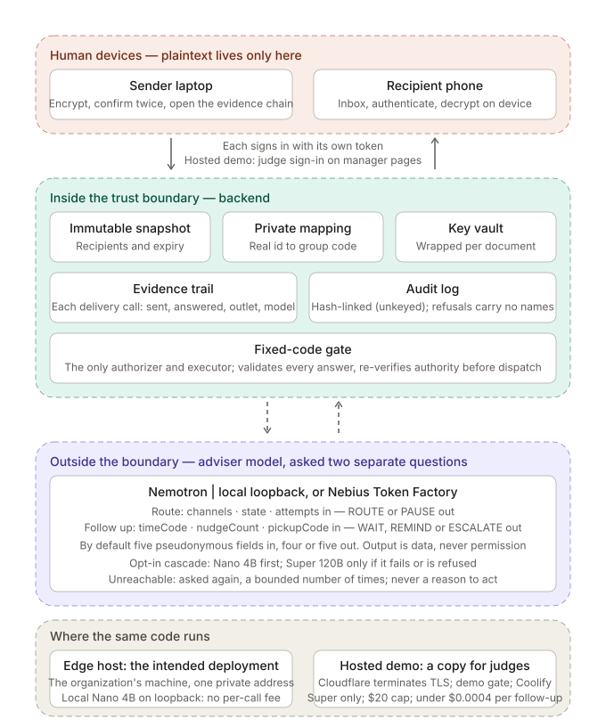
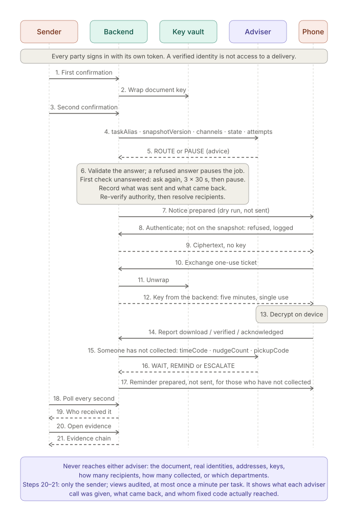
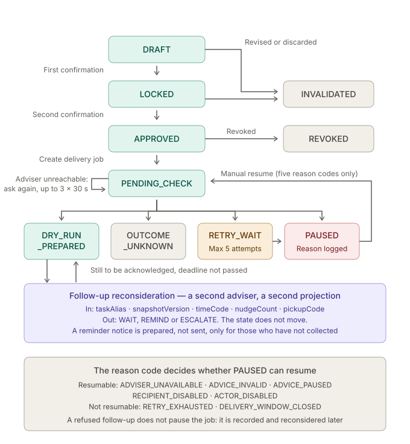

# Zero-Trust Edge Enclave

MIT-licensed encrypted document handoff with a restricted AI adviser. It grew out of the idea behind my earlier Shared Room MCP project; this repository was started on 2026-09-07 as a new codebase. Its claims are measured: the 882 tests and the model comparisons below can be rerun from this tree.

Entry for the Nebius x NVIDIA Global AI Hackathon, track Best Apps and Agents. First commit 2026-09-07, after the hackathon opened on 2026-08-26. The Nemotron models are used through Nebius Token Factory and, locally, through an OpenAI-compatible runtime; they are not bundled here. Super and Nano are under the NVIDIA Nemotron Open Model License; Ultra, measured only as a benchmark, is under OpenMDW-1.1 (see `docs/agent/nvidia-model-provenance.md`). The Token Factory runtime call is `requestFileAdvice` in `file-adviser.js` (POST `/v1/chat/completions`).

**At a glance**

- What it is: encrypted document handoff in which a restricted AI adviser only proposes routing and follow-up; fixed code verifies and executes. Its claims are the tests and measurements below, which a judge can rerun.
- Why a model, and why a local one: the follow-up decision (wait, remind, or raise it to a person, depending on the time left, the ignored reminders and who has collected) is where a rule table runs out and a model adds judgement. On a private network the local Nemotron Nano keeps even the five metadata fields inside the network, needs no internet and no per-call cost; the hosted Nemotron Super on Token Factory is the same contract for teams that want a larger model.
- Two roles, kept apart: a **manager** (sender) on a computer chooses a file and an approved recipient list and confirms twice; an **employee** (recipient) on a phone, from anywhere, opens their **inbox** or the link with only their own token and receives the file decrypted in the browser. The interface shows each role only its own pages (the server enforces roles on every API call), and the employee never meets the hosted demo's shared judge sign-in. Two people can share a name: on the local build the sender tells them apart by employee number (the hosted directory also has two employees named 劉文祥 and one 劉慶龍, so the finder works there too; see the [hosted demo guide](docs/demo/README.md)).
- Two modes, one contract: **edge** (Nemotron 3 Nano 4B on the same machine behind a loopback-only runtime: `LOCAL_ONLY=true`, `COORDINATOR_PROVIDER=local_openai_compatible`) and **hosted** (Nemotron 3 Super 120B on Nebius Token Factory). Switching is configuration, and there is no automatic fallback between them; an explicit, opt-in third value (`COORDINATOR_PROVIDER=local_then_nebius`, default off) asks the local model first and the hosted model only after a local failure, see [cascade outlet](docs/agent/cascade-outlet.md). The edge mode targets organisations that keep files inside a private network; that is the design goal, and what has actually been run is listed in the next point.
- In the file workflow the adviser sees five pseudonymous fields per decision and never the document, the recipient, the address or the key. Two legacy compatibility paths send more to the hosted model (see "Scope of the five-field promise" below); `LEGACY_HOSTED_ADVICE=off` keeps them local.
- Edge mode has been run on a Mac mini (Apple M2 Pro, 16 GB) with LM Studio, the kind of small always-on host it targets: models and data stay on that host and users reach it through one private address or domain. The local figures in this README come from that Mac mini; it has not been run on NVIDIA edge hardware (Jetson, DGX Spark), and a judge with such a device can repeat the same measurement by pointing `LOCAL_MODEL_BASE_URL` at a loopback runtime there.
- Proof: 882 tests in the full suite (`npm run test:all`; with `ffmpeg` installed all 882 run and pass; GitHub Actions runs it on Node 20 and 22 on every push to main and on pull requests, and skips the 6 demo-video composition tests in `scripts/compose-demo-video.test.mjs`, which are gated on `ffmpeg`, which the runner does not have, so its log shows 6 skipped and the rest passing), and a measured comparison of both models on the same inputs: [follow-up comparison](docs/agent/followup-adviser-comparison-2026-10-08.md). 12 of its 36 inputs (everything already collected) are never sent to a model in the product, so read it on the other 24. With the opt-in `FOLLOWUP_PROMPT=directive` profile both models mostly act instead of waiting on those 24 inputs (Nano 4B on 16, Super 120B on 20; single runs, tuned on the same inputs; see [prompt profile](docs/agent/followup-prompt-profile-2026-10-08.md)).
- A real Token Factory call you can see without signing in: `GET https://enclave.jace0423.com/api/health` shows the Token Factory endpoint, the model `nvidia/nemotron-3-super-120b-a12b`, the USD 20 spending cap and the running spend; the recorded Super run on the 36 follow-up inputs had a median of 0.99 s and 36 of 36 accepted answers ([evidence table](docs/agent/adviser-evidence-table-2026-10-29.md)).
- Optional, all off by default: [OIDC single sign-on](docs/agent/sso.md) (tested against a mock identity provider and once against a local Keycloak over loopback http), [signed webhook notices](docs/agent/webhook-notices.md) (link only, no recipients), a failure-driven [local-then-hosted cascade](docs/agent/cascade-outlet.md), and [tooling for human ground-truth labels](docs/agent/human-labels.md) (the labels themselves are the owner's, none exist yet). Each had a red-team pass; the open limits are listed in its document.
- Details: [dual-mode edge](docs/agent/dual-mode-edge.md), [private-network deployment](docs/agent/private-network-deployment.md), [enterprise control mapping and evidence index](docs/compliance/README.md) (a mapping, not a certification), [model provenance](docs/agent/nvidia-model-provenance.md), [server split plan](docs/agent/server-split-plan.md).

## Try It

- **Demo video (under 3 minutes):** https://youtu.be/U2Wym2BYu20. It shows the same-name case, the local Nemotron Nano answering first and Nemotron Super on Token Factory taking over (a real call), the employee's phone inbox and the refusal of the other person.
- **Hosted demo:** https://enclave.jace0423.com. The sender, audit and administration pages sit behind a judge sign-in; an employee who receives a file needs only their own token. Judges find the sign-in and the role tokens in `ZTE-Judges.zip` under "Additional info" on the Devpost submission; they are never committed here. Without them, use [Run Locally](#run-locally), which needs no key.
- **Walkthrough:** [docs/demo/README.md](docs/demo/README.md), step by step: the manager approves a delivery for one person, that employee finds it in their inbox on a phone and decrypts it, a colleague who is signed in but was not picked is refused, and the evidence chain shows exactly what the model was given and answered.
- **Sample documents:** [docs/demo/samples/](docs/demo/samples/), three synthetic files (two PDFs and a CSV) that say so inside.

## Where This Applies

Two places where the wrong person seeing one document is the actual harm. A sales director hands a price quote to two named account managers and later needs to show who received it. A hospital team hands a patient file to the two clinicians treating the case. Hospitals still lean on mail and fax for this kind of exchange: about seven in 10 U.S. non-federal acute care hospitals used mail or fax to send or receive summary of care records in 2018 ([ONC Data Brief No. 51](https://healthit.gov/wp-content/uploads/2020/03/State-of-Interoperability-among-US-Non-federal-Acute-Care-Hospitals-in-2018.pdf)).

Organizations usually decide who may see one sensitive document through an access policy; NIST SP 800-53 control AC-3 describes this as the system enforcing the approvals the organization has granted ([AC-3, access enforcement](https://csf.tools/reference/nist-sp-800-53/r4/ac/ac-3/)). This prototype enforces that kind of rule for one document at a time: only the picked people can open it, and the record shows who did.

It is a prototype built and tested with synthetic documents. It is not certified for medical use and is not meant for classified information. It is meant to run on a host the organization controls (edge mode), which employees reach from their own phones through one private address or domain; the public demo is a hosted copy so that judges can try it. Each person keeps their own token file safe, as with any key.

## Why This Boundary

Data-residency and procurement rules often restrict sending regulated documents to an
external API (this is context, not legal advice, and no specific regulation is cited here). The usual response is to move every
workload on-premises. This prototype takes the other route: keep the workload where it
is and bound what crosses.

What crosses to the model for a routing decision: `taskAlias`, `snapshotVersion`, `channels`, `state`,
`attempts`. Five pseudonymous workflow fields, validated by exact-key and format checks;
anything else is rejected before dispatch.

What never crosses to the file adviser: the document, the recipient, the address, the key. (The follow-up decision, described below, gets a different five fields.)

**Scope of the five-field promise.** It describes the file workflow, which is what this project is
about. Two legacy compatibility paths remain and send more to the hosted model when it is reachable.
`POST /api/policy/recommend` sends six enumerated policy categories (data category, confidentiality,
purpose, expiry, device policy, open limit) whenever `LOCAL_ONLY=false`, a `NEBIUS_API_KEY` is set and
the budget is not spent; it does not look at `COORDINATOR_PROVIDER`. The legacy coordinator
`recommend` tool sends the package's non-content routing metadata, which includes one opaque alias per
recipient and therefore the number of recipients, when `COORDINATOR_PROVIDER=nebius`,
`LOCAL_ONLY=false` and a key is present. Neither carries document content, names, addresses or keys,
but neither is limited to five fields. `LEGACY_HOSTED_ADVICE=off` makes both answer from the local
fixture and never call the hosted model (`/api/health` reports `legacyHostedAdviceOff`).

The opt-in cascade (`COORDINATOR_PROVIDER=local_then_nebius`, default off) stays inside the five-field promise: every decision goes to the loopback model first, and only when that call is unreachable or its output is unusable are the same five fields sent to Token Factory (once per adviser call; a retried decision is a new call, see `docs/agent/cascade-outlet.md`). A valid local answer is never second-guessed. The server refuses to start in this mode unless `LOCAL_ONLY=false`, `LEGACY_HOSTED_ADVICE=off` (because `LOCAL_ONLY=false` is also what opens the two legacy paths) and a Token Factory budget (`NEBIUS_BUDGET_USD` with both prices) are set. The coordinator tool `file_recommend` is answered by the local model only under the cascade. Details: [data protection and retention](docs/compliance/data-protection-and-retention.md).

The adviser's small surface is the design, not an unfinished part. A model is the
component an injected instruction attacks, so it cannot also be the component that
enforces the boundary. Work on tool-using agents has pointed the same way — enforce with
deterministic policy outside the model rather than training it to refuse. The backend here re-verifies identity, authorization, revocation,
snapshot version, channel allowlist, expiry and retry budget on every dispatch, and the
whole workflow completes with `COORDINATOR_PROVIDER=synthetic_fixture` and no model at
all.

Limits: this is a prototype (local, plus one hosted demo instance) whose boundary is checked by its tests, not by a
certification. Keys live in the application process (`local-key-vault.js`); there is no independent KMS or TEE. The five
metadata fields do reach Nebius Token Factory, and the audit page shows each call's exact payload; only the document
content, recipient identity, address and keys are kept inside the boundary.

## Current Workflow

1. Import a sender credential and choose an existing authorization.
2. Select DOCX, PDF or CSV bytes (up to 5 MiB). Browser encryption happens without a document-content preview.
3. Review department-filtered recipients and channels. Confirm twice against the same immutable snapshot; changes require fresh confirmation.
4. A backend worker prepares simulated email notices with bounded retries. AI advice passes fixed authorization checks.
5. The authenticated recipient obtains ciphertext and a separate short-lived, one-use key ticket, decrypts in the browser and downloads the original file.
6. Receipt reports distinguish verification, download request and acknowledgement. Each is a recorded server event that a judge can read on the audit page; none proves reading or legally effective delivery.

The SOC audit page also shows each delivery's evidence chain to its sender: what was approved, the
private mapping, exactly what each routing and follow-up adviser call made by the worker was given (stored at the time of the call, with a
computed check that no real identifier appears in it), what the adviser answered or why its answer
was refused, and how fixed code mapped the outcome back to real recipients, key releases and
receipts. Pages show a token as IDENTITY VERIFIED once the server recognises it, and a recipient's
access as APPROVED or DENIED only on the server's own decision: authentication and authorization are
shown apart.

REQUIRED_ACK adds no extra file cutoff but never bypasses grant expiry or revocation. TIME_LIMITED rejects new access at its approved deadline. Released bytes, keys and plaintext cannot be recalled.

## Run Locally

Requires Node.js 20.11 or newer; no third-party Node runtime packages.

```bash
npm run setup:local
npm test
SKIP_LOCAL_ENV=true LOCAL_ONLY=true npm run dev
```

Open http://127.0.0.1:3344/ or http://127.0.0.1:3344/zh-TW/. The language button switches the current page without reloading.

On the sender page click "Choose token file" and pick the generated operator.token; with a single authorization it is selected for you (otherwise pick local-review). On the recipient page choose recipient-a.token; recipient-b is intentionally unauthorized. Setup generates private random tokens and refuses existing files. These are local bearer identities, not enterprise SSO.

For a separate departmental demo with an administrator:

```bash
node scripts/setup-local.mjs data-business --business
SKIP_LOCAL_ENV=true LOCAL_ONLY=true DATA_DIR=data-business npm run dev
```

Use a new private directory and a free port. Do not share a running server's data directory. Import admin.token only on admin.html for department, person and grant administration. Business setup provides procurement and audit grants.

## NVIDIA / Nebius

Two NVIDIA open models sit behind one contract. `nvidia/nemotron-3-super-120b-a12b` is served by
Nebius Token Factory. `nvidia-nemotron-3-nano-4b` runs on the same machine as the backend through
any OpenAI-compatible local runtime. Switching between them is configuration, not a code change:
the metadata projection, the system boundary, the output schema and `validateFileAdvice` are
identical for both, and only the endpoint rule differs.

That rule is where the two outlets stop being interchangeable. The Token Factory outlet accepts
`https` to `api.tokenfactory.nebius.com` with no port, a backend key, and a model name beginning
`nvidia/`. The local outlet accepts loopback hosts only, because a non-loopback host would make an
external call wearing a local name. It also asks for the schema differently: the runtime rejects
`json_object` and takes `json_schema`. On the runtime measured 2026-09-18 the constraint was what
stopped the model reasoning aloud before it answered. Unconstrained, Nemotron Nano spends 645 to 1089 completion tokens (511 to 1016 of them reasoning) and takes 8.4
to 35.7 seconds; constrained, it answers in 64 to 73 tokens in 3.7 to 4.1 seconds. Since 2026-09-24
LM Studio applies the schema only after reasoning, so the local outlet now also sends
`reasoning_effort: "none"` and temperature 0: 0 reasoning tokens, 40 of 40 accepted at 2.3 to 2.7
seconds per call.

Measured 2026-10-08, same 36 follow-up inputs, same production path, one run each: the local 4B (LM
Studio llama.cpp runtime 2.46.0, one Mac) had a median of 2.86 s per call and 34 of 36 answers
accepted by the validator; the 120B on Token Factory had a median of 0.99 s and 36 of 36 accepted. The
2.3 to 2.7 s figure above was measured on an earlier runtime and is kept as recorded. Both models were
passive near the deadline (4B: WAIT in all 34 accepted answers; 120B: WAIT 31, REMIND 4, ESCALATE 1,
where the deterministic fixture escalates in 12), so the project does not rely on the model to chase:
fixed code decides who is contacted, the validator checks coherence, and the opt-in `FOLLOWUP_FLOOR=true`
escalates a WAIT in the last part of the window. On 2026-10-16 the same 36 inputs were run once on Nemotron 3 Ultra
(`nvidia/Nemotron-3-Ultra-550b-a55b`, default prompt): it escalated in 11 of the 12 inputs where the fixture escalates, with a
median of 0.9 s (33 of its 36 answers passed the validator), so a larger model is decisive where the default prompt makes the 4B and the 120B passive. The optional `NEBIUS_MODEL_FOLLOWUP`
puts a different hosted model on the follow-up decision only (routing keeps `NEBIUS_MODEL`), and the evidence chain names the
model that answered each call. The fixture is not ground truth. See the
[follow-up comparison](docs/agent/followup-adviser-comparison-2026-10-08.md).

Neither is the boundary. `validateFileAdvice` decides what is valid, and a schema the server honours
only means fewer answers reach it malformed.

Where Token Factory carried the work: a 120B-class model was reachable over a plain
OpenAI-compatible endpoint, so no GPU had to be provisioned, no weights served and no bespoke client
written. That endpoint shape is also what made the two-outlet design possible at all. One request
builder reaches a hosted 120B model and a local 4B model without branching, so the comparison this
project needs -- a large hosted model and a small local one under identical constraints -- is a
configuration switch rather than two separate integrations.

No other Nebius service is used. There is no AI Cloud deployment, no Serverless Endpoint and no
Serverless Job. The application runs as a single Node process with no third-party runtime packages
and reaches Token Factory over the chat completions API.

Default mode is `synthetic_fixture` and issues no model request. An opt-in cascade, `COORDINATOR_PROVIDER=local_then_nebius`, asks the local model first and the hosted one only after a failed local call ([cascade outlet](docs/agent/cascade-outlet.md)). Token Factory advice requires
`LOCAL_ONLY=false`, `COORDINATOR_PROVIDER=nebius` and a backend `NEBIUS_API_KEY`; a key alone does
not enable it. Local Nano advice uses `COORDINATOR_PROVIDER=local_openai_compatible` with a
loopback `LOCAL_MODEL_BASE_URL` and no key. Configure an untracked environment file using `env.sample`, and start without
`SKIP_LOCAL_ENV=true` only when deliberately loading that private configuration. Never place secrets
in Git, browser code or model context.

The hosted instance has a USD 20 Token Factory spending cap that the server enforces in code from its own count of token usage at configured prices (an estimate, not Nebius billing). Once it is spent, the advisers fall back to
synthetic advice and every other step keeps working; the current state is under `nebiusBudget` in
`/api/health`.

Two decisions sit behind that contract, each with its own five-field projection and its own
validator. Routing is asked whether a prepared job should go out on an approved channel or hold:
`taskAlias`, `snapshotVersion`, `channels`, `state`, `attempts`, answered with `ROUTE` or `PAUSE`.
Follow-up is asked what to do about a delivery that must be acknowledged and that nobody has
collected: `taskAlias`, `snapshotVersion`, `timeCode`, `nudgeCount`, `pickupCode`, answered with
`WAIT`, `REMIND` or `ESCALATE`.

Neither adviser can read documents, addresses, real identities or keys, change recipients, extend
expiry or authorize execution, and neither is told who the recipients are, how many there are, or
how they are grouped. The follow-up projection is starved further still: `timeCode` is a countdown of
how much of the task's own window is left, in words (`WINDOW_FULL`, `WINDOW_MOST`, `WINDOW_LITTLE`, `WINDOW_LAST`) rather than a time, so an identical value means a different hour on a two-day
task and a two-month one, and `pickupCode` is `PICKUP_NONE`, `PICKUP_SOME` or `PICKUP_ALL`, never a
count. Fixed code decides who a reminder notice is prepared for (the prototype prepares it and sends nothing), resolving it from receipts the adviser never saw.

Real provider calls, input rejection and injected-output gate tests were recorded separately during
development, including earlier failed calls and their successful retests. One earlier conclusion was
wrong and is corrected here rather than quietly dropped: constrained decoding on the local runtime
was recorded as returning empty content, when it returns a complete and correct answer assembled
into `reasoning_content` while `content` is left empty. A client reading only `content` sees an
empty success. These results cover the calls, inputs and runtimes recorded in `SECURITY_SCAN_EVIDENCE.md` and the
comparison documents, and `scripts/bench-adviser.mjs` reruns the model comparison; they do not prove
superiority to deterministic routing, general injection resistance, or compatibility with an untested
local runtime.

`npm test` runs one file, `scripts/local-workflow.test.mjs` (117 tests). The full suite is `npm run test:all` (see the test count in the Proof line at the top).

`node scripts/compare-followup-advisers.mjs` (no network, no key) prints the lookup table in `followup-table.js` next to the recorded Nemotron runs on the same 36 inputs, recomputed row by row: coherence on the production validator, agreement with the table, ESCALATE on the 12 inputs where the table escalates, and latency. With `NEBIUS_API_KEY` set, `--cloud --yes-spend --thinking both` adds two live columns (`enable_thinking` false and true) through the production request path, 12 calls by default and never more than `--max-calls` (default 20). The combined evidence table is [adviser evidence table](docs/agent/adviser-evidence-table-2026-10-29.md).

## Architecture

Three views, redrawn on 2026-09-25 against the code as it now stands (the trust-boundary view was updated on 2026-10-16: the evidence trail names the model, and a bottom band shows the edge host and the hosted demo). Each is drawn from the
implementation, not from intent: the state names come from the audit allowlist in
`audit-boundary.js`, the resumable reason codes from `task-operations.js`, the adviser projections
from `file-routing.js` and `delivery-followup.js`, and the evidence chain from `task-evidence.js`.

**What each party can reach.** Plaintext exists only on the two human devices, and each signs in with
its own token (the hosted demo adds a judge sign-in in front of the sender, audit and administration pages only). The backend holds the document key and releases it to an approved recipient, so what the tests enforce is that no unapproved recipient and no adviser call ever receives the key, not secrecy from whoever operates the server (this is not end-to-end encryption); demo files are synthetic. Inside the boundary, next to the
snapshot, mapping and key vault, the backend keeps an evidence trail of every adviser call and a
hash-chained audit log (unkeyed SHA-256 links: `node scripts/verify-audit-chain.mjs <DATA_DIR>` detects edits, deletions and reordering, but not tail truncation or a full rewrite by someone who can recompute every hash). The adviser sits outside and is reached by two dashed edges and nothing else;
the hosted Token Factory outlet is behind a spending cap.



**The order things happen in.** Twenty-one messages from double confirmation to the evidence chain. (In the browser the file task and its wrapped document key are created first; the first confirmation then locks that draft.)
The adviser appears twice and nowhere else: once at steps 4 and 5 to choose a route, and again at
steps 15 and 16 while someone on a delivery that must be acknowledged has not collected. Between
them, fixed code validates the answer, asks again if the adviser could not be reached, and records
what was sent and what came back. The adviser is absent for the key exchange, the decryption and the
reporting. At steps 20 and 21 the sender, and only the sender, opens that record; viewing it is
itself audited, at most once per task per minute.



**What a task can do next.** Ten states and the reason codes that decide whether a paused job may
resume. `RETRY_EXHAUSTED` and `DELIVERY_WINDOW_CLOSED` both stop a job, for different reasons: the
first has spent its attempts, the second still has attempts but the download window closed first.
An adviser that cannot be reached decided nothing, so a first routing check stays in
`PENDING_CHECK` and asks again, up to three times 30 seconds apart, before it pauses for a person.



Polling is drawn as polling. The sender's page asks the backend once a second; there is no push
channel, and none is claimed.

The stdio MCP adapter exposes metadata-only file_status/file_recommend and legacy compatibility tools. It cannot deliver file bytes or release credentials. See [MCP permissions](MCP_SERVER_ALLOWLIST.md).

Backend storage includes ciphertext AND wrapped keys. The key service shares the app host and process: a compromised backend is outside this prototype's protection boundary, and [THREAT_MODEL.md](THREAT_MODEL.md) lists which attacks the tests do cover. No independent KMS or hardware enclave is claimed.

## Verification And Limits

```bash
npm run check
npm test
npm run test:all
node scripts/generate-business-fixtures.mjs
```

`npm run check` syntax-checks every JavaScript file in the repository (`scripts/check-syntax.mjs`). It does not run any test. `npm test` runs only `scripts/local-workflow.test.mjs`; the full suite is `npm run test:all`, which GitHub Actions also runs (it works on Node 20, where `node --test` does not expand the `scripts/*.test.mjs` pattern).

Tests use isolated synthetic stores and no provider requests. The fixture generator creates synthetic CSV and native-document source data, never reads user documents, and refuses differing existing outputs. Optional native rendering/browser testing is documented in [local workflow](docs/agent/local-workflow.md).

Optional hardening, described in [private-network deployment](docs/agent/private-network-deployment.md): `ALLOWED_CLIENT_CIDRS` (refuse clients outside listed networks), `TRUST_PROXY` (take the client address from `X-Forwarded-For` behind a proxy that overwrites it), `AUTH_MAX_FAILURES` / `AUTH_WINDOW_SECONDS` / `AUTH_LOCK_SECONDS` (failed sign-in throttle, which is on by default with 10 / 60 / 60) and `TLS_CERT_FILE` / `TLS_KEY_FILE`. `FOLLOWUP_FLOOR=true` (also off by default) makes fixed code escalate to a person when the follow-up adviser answers WAIT in the last part of the window with the pickup incomplete; the adviser's own answer stays in the evidence trail. Prepared dry-run notices are also appended to `<DATA_DIR>/outbox/notices.jsonl` for a gateway you operate, with group codes only and no sending. Beyond loopback, https is required: the document key is returned in a JSON response and Web Crypto needs a secure context.

Email remains dry-run: prepared notices are appended to `<DATA_DIR>/outbox/notices.jsonl`, where a judge can read exactly what would have been sent. Beyond the optional OIDC sign-on, no enterprise identity is implemented, and neither are malware inspection of ciphertext, legal signature or a multi-host delivery guarantee. Legacy text/passphrase endpoints are compatibility paths, not this file workflow.

[Security](SECURITY.md) | [Threat model](THREAT_MODEL.md) | [Release review](docs/agent/security-gate-summary.md) | [Export manifest](public-export-manifest.md)

A hosted instance for judges runs at https://enclave.jace0423.com (a small Cloudflare Worker in front of it passes each visitor's real address to the server, so one visitor's failed attempts do not count against everyone; see `deploy/cloudflare-edge/` and SECURITY.md). The sender, audit and administration pages are behind a judge sign-in; an employee needs only their own token. The sign-in and the role tokens are in `ZTE-Judges.zip` under "Additional info" on the Devpost submission, and the walkthrough is in [docs/demo/README.md](docs/demo/README.md). See [Hosted deployment notes](docs/agent/zeabur-deployment.md); since 2026-10-22 the edge forwards to a Coolify instance of the same commit on a patched Node 22, as that document records.
